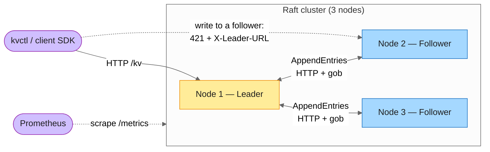
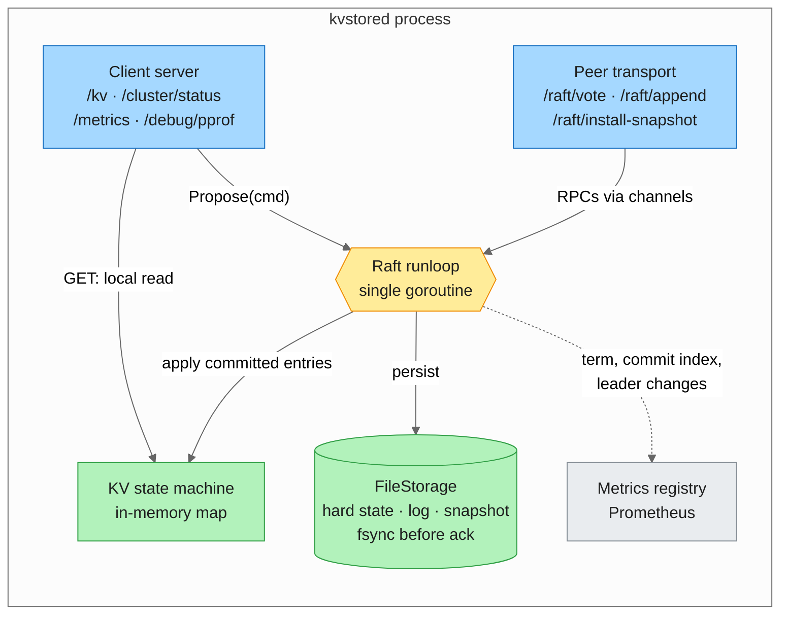
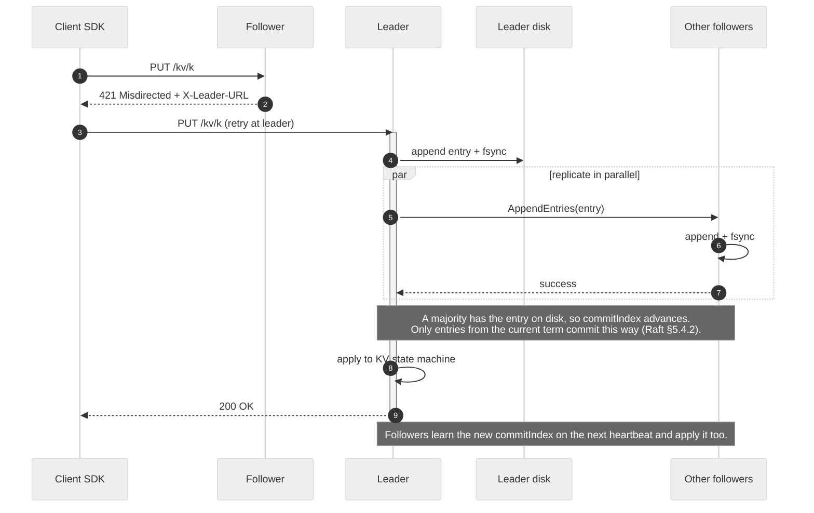
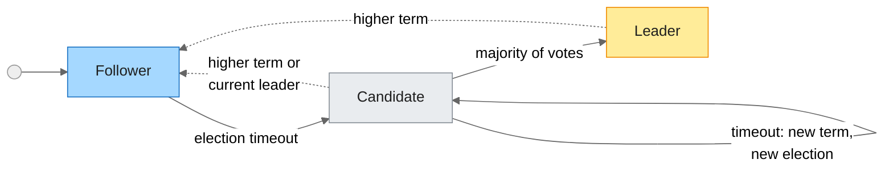
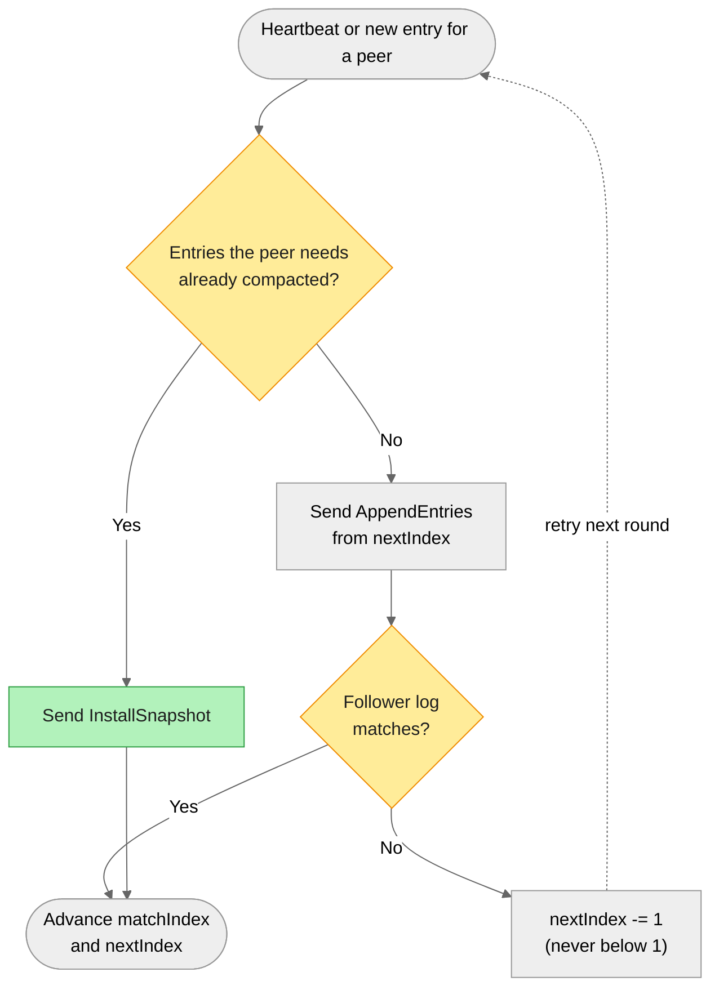

# Distributed Key-Value Store

[](https://github.com/DhruvGandhi31/Distributed-Key-Value-Store/actions/workflows/ci.yml)
[](https://goreportcard.com/report/github.com/DhruvGandhi31/Distributed-Key-Value-Store)
[](https://pkg.go.dev/github.com/DhruvGandhi31/Distributed-Key-Value-Store)
[](LICENSE)

A from-scratch, fault-tolerant, distributed key-value store built on a **custom Raft consensus implementation** — no third-party Raft library. Built incrementally, one phase at a time. 

## Why this project exists

Most Raft implementations you can find are libraries you import and trust. This one is built from first principles — leader election, log replication, crash recovery, snapshotting, and a leader-aware client — to actually understand the algorithm and the hard edges around it (split votes, log divergence, fsync ordering, lagging followers) rather than just consume it.

## Status

🚧 **Under active, incremental development.** Phases 1–9 are done: a single-node KV store, custom Raft leader election, log replication, crash recovery, snapshotting, a leader-aware smart client, a real automated test suite, and a live deployment — writes are proposed through Raft, replicated to a majority, durably fsync'd, survive killing every node in the cluster and restarting from cold, and each node compacts its own log automatically so it doesn't grow unboundedly. A follower too far behind for ordinary replication catches up via a snapshot transfer instead of a full historical replay. `kvctl`/the client SDK never need to know which node is the leader — a write to any node either applies directly or gets transparently redirected. The crash-recovery, snapshot-catchup, and failover checkpoints above are all covered by integration tests that spin up a real multi-node cluster over real HTTP (`tests/integration`), not just manual verification. The cluster also runs as a 3-pod Kubernetes (k3s) StatefulSet on a cloud VM, reachable and verified from outside the cluster entirely. See the [Roadmap](#roadmap) below for what's built and what's next. Follow along in [`build-guide.md`](build-guide.md) for the full phase-by-phase design and implementation notes.

## Features

Planned, in build order (see [Roadmap](#roadmap)):

- In-memory KV store with `PUT` / `GET` / `DELETE` / prefix `SCAN` / compare-and-swap
- Custom Raft consensus: leader election, log replication, majority commit
- Crash-safe persistence via a write-ahead log (WAL) with fsync
- Snapshotting and log compaction so the WAL doesn't grow unboundedly, with `InstallSnapshot` catch-up for lagging followers
- A smart client SDK (`internal/client`) that transparently finds the leader (via HTTP 421 + `X-Leader-URL`) and retries across a candidate node set on failover
- Unit tests for every internal package plus real multi-node integration tests (`tests/integration`) covering leader election, failover, full-cluster restart, and snapshot catch-up over real HTTP
- Dockerized 3-node cluster, deployable with one command
- Deployed as a 3-pod Kubernetes (k3s) StatefulSet on a cloud VM (`deployments/k8s`)
- Prometheus metrics at `/metrics`, structured `log/slog` logging (`--log-format text|json`), and CPU/memory profiling at `/debug/pprof/`

## Architecture

### Cluster overview

Every node holds a full replica. Only the leader accepts writes; it replicates them to followers over a separate peer port, and an entry commits once a majority has it durably on disk.



### Inside one node

Each node runs two HTTP listeners, one for clients and one for Raft peers. Everything Raft-related goes through **one runloop goroutine** that owns term, vote, log, and commit index. Other goroutines reach it through channels rather than shared locks. The KV store is a pluggable state machine and only ever sees committed entries, in log order.



> Reads are served from the local state machine on whichever node receives them, so a follower or a partitioned old leader can return stale data. Linearizable reads (read-index) are planned for Phase 10.

### Write path

What happens on `kvctl put k v` when the client starts out talking to a follower:



### Raft roles



Dotted arrows are step-downs: any RPC that carries a higher term sends a node straight back to Follower.

- `votedFor` and `currentTerm` are fsync'd **before** any RequestVote goes out. A node that crashes mid-election can't vote twice in the same term.
- A new leader immediately appends a **no-op entry** for its term. Raft only commits older entries indirectly, through a current-term entry, so without the no-op a cluster restarted from cold could never re-advance its commit index until a client wrote something.

### Catching up a lagging follower

Every node compacts its own log into a snapshot once it has applied `--snapshot-interval` entries. If a follower is so far behind that the entries it needs have already been compacted on the leader, the leader sends its snapshot instead:



### Deployment (Kubernetes / k3s)

The live cluster runs as a 3-replica StatefulSet on a single k3s VM. Each pod gets its own persistent volume and its own public port. A follower's redirect has to send an outside client to the leader's public address, and a single shared load balancer can't provide one stable address per pod.


Full design rationale lives in [`build-guide.md`](build-guide.md); per-phase decisions and bugs found along the way are in [`docs/`](docs/).

## Getting Started

```powershell
go build -o bin/kvstored.exe ./cmd/server
go build -o bin/kvctl.exe ./cmd/client
go vet ./...
go test -race -timeout 120s ./...   # includes tests/integration: real multi-node clusters over real HTTP
```

### Single node (no Raft)

```powershell
.\bin\kvstored.exe --client-addr 127.0.0.1:8000
# in a second terminal:
.\bin\kvctl.exe put hello world
.\bin\kvctl.exe get hello
```

### 3-node Raft cluster (replicated writes)

```powershell
.\scripts\cluster.ps1 -Action start
.\scripts\cluster.ps1 -Action status   # shows which node is leader, and at what term

# as of Phase 6, a write to ANY node works — a follower transparently
# redirects the smart client to the leader, so you don't need to know
# which node that is:
.\bin\kvctl.exe -addr http://127.0.0.1:8002 put hello world
.\bin\kvctl.exe -addr http://127.0.0.1:8002 get hello
Invoke-WebRequest http://127.0.0.1:8002/cluster/status -UseBasicParsing | Select -Expand Content

.\scripts\cluster.ps1 -Action stop
```

> `node4` is always part of every node's configured peer set (see below), even when its process isn't running — so a plain `-Action start` cluster is really a 4-node Raft group with only 3 processes alive. That's still a majority (3 of 4) for normal operation, but killing one of those 3 afterward would drop you to 2 of 4 — **not** a majority — and the cluster would never re-elect. Use `-IncludeNode4` (see the next section) for any test that kills a node and expects a survivor to take over.

### Crash recovery (kill every node, restart from cold)

```powershell
.\scripts\cluster.ps1 -Action stop     # kill ALL nodes, not just the leader
.\scripts\cluster.ps1 -Action start    # restart the whole cluster from disk
.\scripts\cluster.ps1 -Action status   # term should be higher than before, not reset

# no write happens here — this reads purely from what survived the restart:
.\bin\kvctl.exe -addr http://127.0.0.1:8001 get hello
```

### Snapshotting and log compaction

```powershell
# --snapshot-interval controls how often (in applied entries) each node
# compacts its own log; defaults to 1000, set low here just to see it fire
.\scripts\cluster.ps1 -Action start -SnapshotInterval 20

# write past the interval a few times over
1..60 | ForEach-Object { .\bin\kvctl.exe -addr http://127.0.0.1:8001 put "key$_" "value$_" }

# each node has independently snapshotted and compacted its own log by now
Select-String -Path .\data\logs\node1.log -Pattern "snapshot taken"

# bring a cold node online after the leader has already compacted its log —
# it catches up via a snapshot transfer, not a full historical replay
.\scripts\cluster.ps1 -Action start-node4
.\bin\kvctl.exe -addr http://127.0.0.1:8004 get key1

.\scripts\cluster.ps1 -Action stop
```

### Leader failover (smart client transparently follows the new leader)

```powershell
# node4 always counts toward quorum once it's in the peer list (see the
# note above) — include it so a single kill still leaves a majority:
.\scripts\cluster.ps1 -Action start -IncludeNode4
.\scripts\cluster.ps1 -Action status   # note the leader's PID

.\bin\kvctl.exe -addr http://127.0.0.1:8003 put before-failover value1

Stop-Process -Id <leader's PID from above> -Force
.\scripts\cluster.ps1 -Action status   # a different node leads now, higher term

# same command, same follower address the whole time — the SDK found the
# new leader on its own:
.\bin\kvctl.exe -addr http://127.0.0.1:8003 put after-failover value2
.\bin\kvctl.exe -addr http://127.0.0.1:8003 get after-failover

# --addr also accepts a comma-separated fallback list, so kvctl recovers
# even if the first address you give it happens to be down:
.\bin\kvctl.exe -addr "http://127.0.0.1:8001,http://127.0.0.1:8002,http://127.0.0.1:8003,http://127.0.0.1:8004" get after-failover

.\scripts\cluster.ps1 -Action stop
```

## Roadmap

- [x] Phase 1 — Single-node KV store (in-memory, HTTP API, CLI)
- [x] Phase 2 — Raft core: leader election
- [x] Phase 3 — Log replication
- [x] Phase 4 — Persistent storage (WAL + crash recovery)
- [x] Phase 5 — Snapshotting and log compaction
- [x] Phase 6 — Smart client and CLI (leader redirection, retries)
- [x] Phase 7 — Testing (unit + integration) and CI
- [x] Phase 8 — Docker and deployment (Dockerized 3-node local cluster, and a live 3-pod k3s StatefulSet on Google Cloud)
- [x] Phase 9 — Observability (metrics, structured logging, pprof)
- [ ] Phase 10 — Advanced Raft hardening (pre-vote, read-index, joint consensus, TLS)
