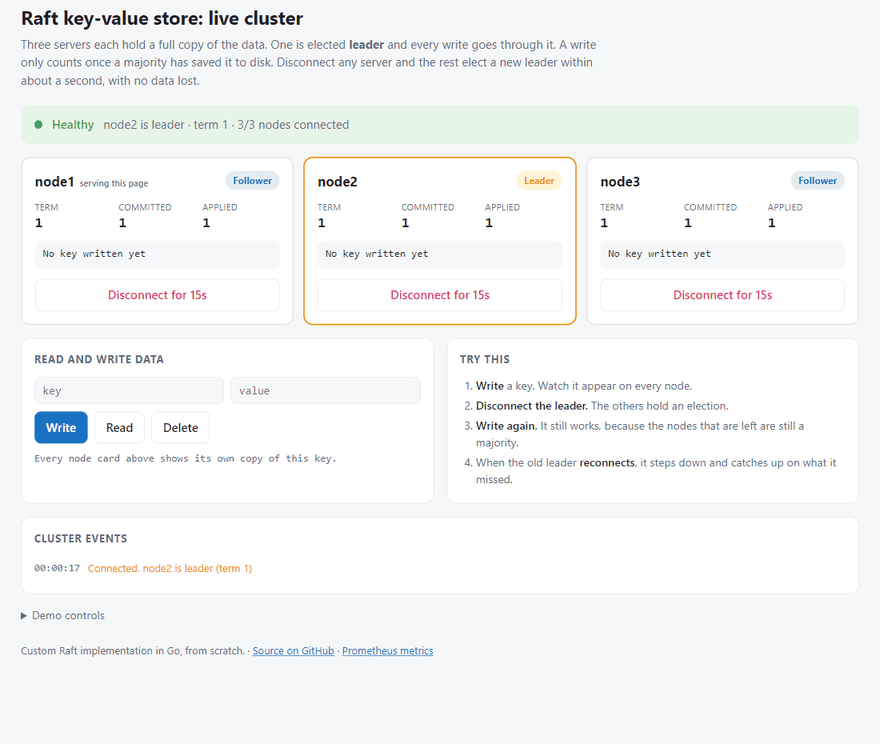
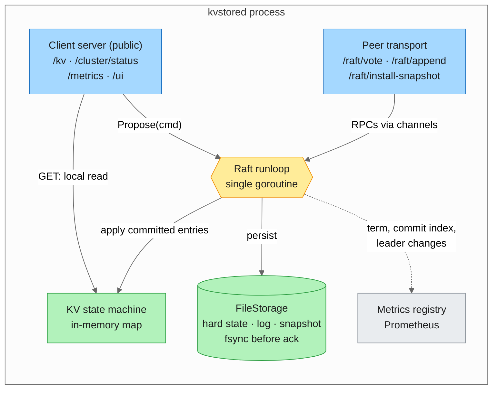
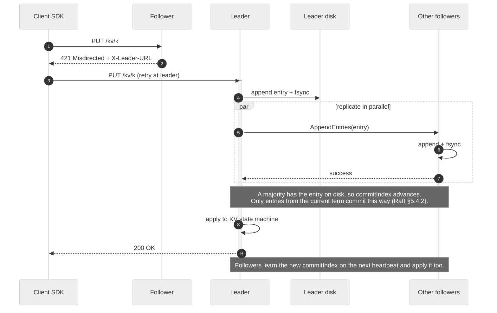
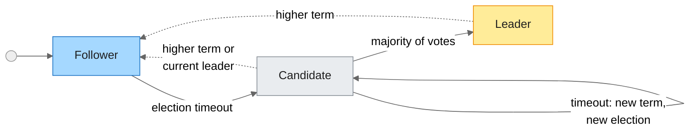
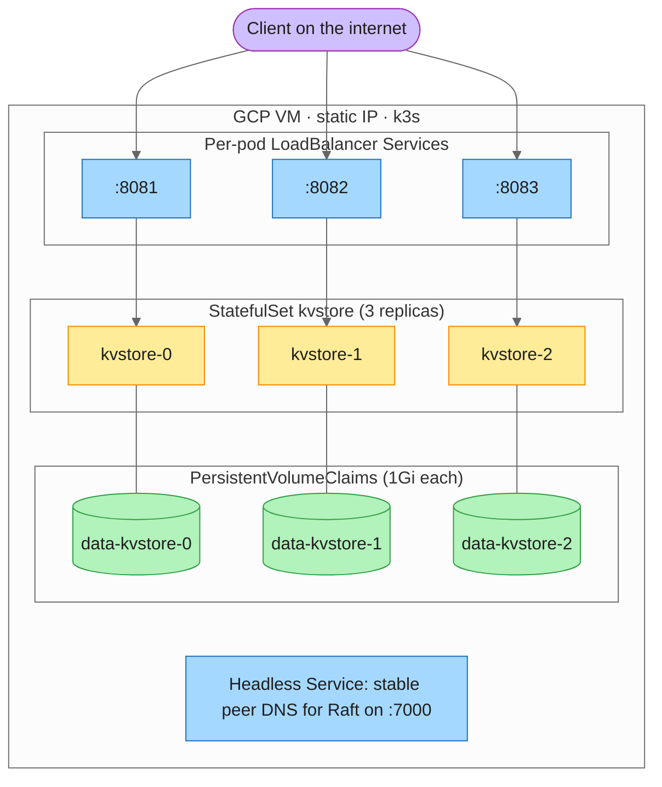

# Distributed Key-Value Store

[](https://github.com/DhruvGandhi31/Distributed-Key-Value-Store/actions/workflows/ci.yml)
[](https://goreportcard.com/report/github.com/DhruvGandhi31/Distributed-Key-Value-Store)
[](https://pkg.go.dev/github.com/DhruvGandhi31/Distributed-Key-Value-Store)
[](LICENSE)

**A database that keeps working when servers fail.** Three servers each keep a full copy of the data. If one crashes or gets cut off, the others elect a new leader in under a second (typically 0.3 s) and keep accepting writes, with nothing lost.

Under the hood, it's a fault-tolerant, highly available distributed key-value store built on my own implementation of the **Raft consensus algorithm** in Go, written from scratch with no Raft library. It is deployed on Kubernetes on Google Cloud.

**[▶ Open the live dashboard](http://34.60.149.77:8081/ui)**: watch the real cluster running on Google Cloud. It's a read-only view and safe to click. The "disconnect a server" button needs a demo token so strangers can't take the cluster down; the recording below shows what it does.



<sub>The built-in dashboard during a real failover, recorded from a running cluster rather than a mock-up. The leader is cut off, the other two elect a new one, a write during the outage still succeeds, and the old leader steps down and catches up when it returns.</sub>

## At a glance

| | |
|---|---|
| **~0.3 s** | median leader failover (20 measured trials, worst case 1.3 s) |
| **< 5 ms** | typical time to save a write, including copying it to disk on a majority of servers (a blink takes ~100 ms; [details](#performance)) |
| **0** | confirmed writes lost in failure tests (leader crash, every server restarting at once, a server catching up after falling behind) |
| **78 tests, 77% coverage** | unit and integration tests, re-run with a concurrency-bug detector on every push |
| **~3,300 lines of Go** | plus ~2,600 lines of tests; standard library plus one dependency (Prometheus client) |
| **3 replicas** | Kubernetes StatefulSet on Google Cloud, persistent volumes, live public endpoint |
| **9 phases shipped** | each with a design write-up in [`docs/`](docs/); the next phase is on the [roadmap](#roadmap) |

## In plain English

Picture three bank tellers who must agree before any transaction goes into the ledger. One acts as the lead teller. Every change goes through them and only counts once most tellers have written it down. If the lead teller walks away, the others quickly pick a new one and carry on. When the missing teller returns, they copy whatever they missed.

That agreement process is called **consensus**. It is what lets systems like etcd (the database behind Kubernetes), CockroachDB and Consul survive hardware failures without losing data. This project implements it from first principles instead of importing a library.

## What this project demonstrates

| Area | What I built |
|---|---|
| **Distributed systems and system design** | A fault-tolerant, highly available design: leader election, log replication, majority commit, crash recovery, log compaction with snapshot transfer, and leader redirection, all from the Raft paper |
| **Correctness under failure** | Data is written to disk before it is acknowledged. 78 tests (77% statement coverage), including integration tests that start real multi-node clusters, kill nodes and check that no data is lost |
| **Backend engineering (Go)** | REST API over HTTP, a smart client SDK with retries and leader caching, and a CLI. One goroutine owns all consensus state and everything else talks to it over channels instead of shared locks |
| **Cloud and DevOps** | Multi-stage Docker build to a distroless image (under 30 MB), Kubernetes StatefulSet with persistent volumes on a Linux (Ubuntu) VM on GCP with a static IP, secrets via Kubernetes Secrets, and GitHub Actions CI running vet, race-detector tests and builds |
| **Observability** | 6 custom Prometheus metrics plus Go runtime metrics, structured JSON logging (`log/slog`), and CPU/memory profiling (`pprof`) on a private port |
| **Performance measurement** | A load generator ([`cmd/bench`](cmd/bench/main.go)) measuring write latency percentiles, throughput and failover time (see [Performance](#performance)) |
| **Product sense** | A live dashboard that turns an invisible algorithm into something you can see and break during a demo |

## Engineering highlights

Bugs I found along the way are often the more interesting part:

- **"Lost" data after a full restart that wasn't actually lost.** After every node restarted at once, committed data sat safely on disk but never came back. Raft's safety rules stop a new leader from committing older entries directly, so nothing could be replayed until a client happened to write. The fix, which etcd also uses, is for each new leader to immediately write an empty entry for its own term. [Phase 4 write-up](docs/phase-4-persistent-storage.md)
- **A race between log compaction and retransmission.** Because every node compacts its own log independently, a follower could receive an entry it had already compacted away and reject the whole batch. A test written specifically for lagging followers caught it, with only 2 of 10 entries arriving. [Phase 5 write-up](docs/phase-5-snapshotting.md)
- **Redirects that worked inside Kubernetes but not outside it.** Followers were redirecting clients to internal cluster DNS names that nobody on the internet can resolve. I fixed it by giving each pod its own public address. [Phase 8 write-up](docs/phase-8-docker-and-deployment.md)
- **A silently ignored flag.** A path with spaces caused the cluster script to drop later command-line flags, so nodes were writing to the wrong directory. Unit tests couldn't catch this; running the real cluster did. [Phase 5 write-up](docs/phase-5-snapshotting.md)
- **Two bugs a code review caught, both now covered by tests.** A node recovering from a crash in the middle of a disk write skipped the half-written record but left it in the file, so writes made afterwards were lost on the *next* restart. Separately, a follower could mark entries as committed that the leader had never confirmed. Each fix has a test that fails on the old code.

## How it works


1. **One leader.** The nodes elect a leader. If it goes silent for 300–600 ms (randomized per node), the others hold a new election.
2. **Every write goes through the leader.** It saves the write to its own disk and sends it to the followers. Once a **majority** has it on disk, the write is committed and the client gets an OK.
3. **Clients don't need to know who leads.** A follower answers with a redirect to the current leader, and the client SDK follows it automatically.
4. **Logs don't grow forever.** Each node periodically compacts its log into a snapshot. A follower that falls far behind is sent the snapshot instead of the full history.

## Architecture

Five diagrams: inside one node, the write path, Raft roles, how a lagging server catches up, and the Kubernetes deployment.

<details>
<summary><b>Show the architecture diagrams</b></summary>

### Inside one node

Each node runs two HTTP listeners, one for clients and one for Raft peers. Everything Raft-related goes through **one runloop goroutine** that owns the term, vote, log and commit index. The key-value store only ever sees committed entries, in log order.



### Write path

What happens on `kvctl put k v` when the client starts out talking to a follower:



### Raft roles



Dotted arrows are step-downs: any message that carries a higher term sends a node straight back to Follower. A node saves its vote to disk **before** asking for votes, so a crash mid-election can never make it vote twice in the same term.

### Catching up a lagging follower

If a follower is so far behind that the entries it needs have already been compacted on the leader, the leader sends its snapshot instead:


### Deployment on Kubernetes (k3s on Google Cloud)

A 3-replica StatefulSet on a single k3s VM. Each pod gets its own persistent volume and its own public port, so a follower's redirect can point an outside client at the leader's real public address.



</details>

More detail, including how the live dashboard and its fault injection work, is in [docs/architecture.md](docs/architecture.md).

## Performance

Measured on a local 3-node cluster (Windows laptop, Intel i7-13650HX, SSD), with every write replicated to a majority and fsync'd before it is acknowledged. Numbers are from two separate runs:

| Metric | Result |
|---|---|
| Write latency, sequential (1,000 writes per run) | p50 **2.7–5.0 ms**, p95 3.9–6.7 ms, p99 4.6–8.6 ms |
| Write throughput, 8 concurrent clients (10 s per run) | **~370–475 writes/s**, 0 errors |
| Leader failover: leader cut off → new leader elected (20 trials) | median **0.29–0.36 s**, min 0.26 s, max 1.26 s |
| Leader failover: leader cut off → first write accepted again | median **0.29–0.38 s**, max 1.27 s |

Failover time is mostly the election timeout itself (300–600 ms, randomized so nodes rarely tie). The worst cases are split votes that need a second round.

**Known bottleneck:** throughput doesn't grow with more clients yet; with 32 clients it falls to ~150–200 writes/s. Each write currently gets its own disk flush and its own replication round. Batching writes is part of Phase 10, and these numbers are the baseline it will be measured against.

To reproduce, start a scratch cluster with a demo token and run the included load generator, [`cmd/bench`](cmd/bench/main.go), passing every node's address:

```powershell
go build -o bin/kvbench.exe ./cmd/bench
.\bin\kvbench.exe -nodes "http://127.0.0.1:8001,http://127.0.0.1:8002,http://127.0.0.1:8003" -token <demo token>
```

Full steps are in [Running locally](docs/running-locally.md#benchmark).

## Design decisions

| Decision | Instead of | Why, and what it costs |
|---|---|---|
| **One goroutine owns all Raft state**; RPCs and client requests reach it over channels | Mutexes around shared state | Every state change happens in a single sequence, so there are no lock-ordering bugs and the code reads like the Raft paper. The cost is a channel hop on every request. |
| **Write to disk and fsync before acknowledging** a vote or log entry | Acknowledge first, persist later | A crash can never lose an acknowledged write or let a node vote twice in one term. The cost is one fsync per write (see the bottleneck above). |
| **HTTP + `encoding/gob`** between nodes | gRPC + Protocol Buffers | Standard library only, with no code generation or extra toolchain. The cost is a Go-only wire format and no streaming. |
| **Fixed cluster membership**, set at startup | Adding and removing nodes at runtime | Safely changing membership needs joint consensus, a project of its own. For now the cluster size can't change while it runs; this is planned for Phase 10. |
| **Each node snapshots its own log independently** | Only the leader snapshots and ships it | No network traffic for routine compaction. The cost is an edge case where a follower receives entries it already compacted, which this caused and which is now handled (see the highlights below). |

## How it's tested

78 automated tests with 77% statement coverage, run under Go's race detector on every push:

- **Real clusters, real failures.** Integration tests start three nodes over real HTTP inside the test process, then kill the leader mid-session, kill and restart *every* node at once, or start a node late so it must catch up from a snapshot. The tests then check that every committed write is still there.
- **Raft rules tested one at a time.** Unit tests run nodes on a fake in-memory network to check the subtle rules directly. A node never votes twice in a term. A rejected message doesn't reset the election timer. A stale vote reply is ignored. A leader never directly commits an entry from an older term (the Raft paper's "Figure 8" case).
- **Crash safety on disk.** Storage tests cut off a write halfway (a "torn write") and check that the node recovers a valid log, that writes made after recovery survive the next restart, and that the log file shrinks after a snapshot.
- **Fault injection you can watch.** The same network cut used by the dashboard is unit-tested to drop traffic in both directions and heal on its own.

## Try it

**Any OS, with Docker:**

```bash
docker compose up -d --build
docker compose exec node1 /kvctl -addr http://node1:8000 put hello world
docker compose exec node2 /kvctl -addr http://node2:8000 get hello   # read it back from another node
docker compose down -v
```

**Native, with the dashboard (Windows / PowerShell):**

```powershell
go build -o bin/kvstored.exe ./cmd/server
go build -o bin/kvctl.exe ./cmd/client

$env:KV_DEMO_TOKEN = "pick-any-secret"
.\scripts\cluster.ps1 -Action start -IncludeNode4
Start-Process "http://127.0.0.1:8001/ui?token=pick-any-secret"   # the dashboard above

.\bin\kvctl.exe -addr http://127.0.0.1:8002 put hello world      # any node works, followers redirect
.\bin\kvctl.exe -addr http://127.0.0.1:8003 get hello
```

More scenarios (crash recovery, snapshot catch-up, failover from the CLI, benchmarks) are in [Running locally](docs/running-locally.md). Kubernetes manifests are in [`deployments/`](deployments/).

## Tech stack

- **Language:** Go (standard library, plus `prometheus/client_golang`)
- **Distributed systems:** Raft consensus (custom implementation), replication, leader election, write-ahead log, snapshots
- **Networking:** HTTP / REST API, `encoding/gob` RPC between nodes, CORS
- **Infrastructure:** Linux (Ubuntu), Docker (multi-stage, distroless), Docker Compose, Kubernetes (k3s, StatefulSet, Services, PersistentVolumeClaims, Secrets), Google Cloud (Compute Engine, static IP, firewall rules)
- **CI/CD:** GitHub Actions, GitHub Container Registry (GHCR)
- **Observability:** Prometheus metrics, structured logging (`log/slog`, JSON), `pprof` profiling
- **Frontend:** a single HTML/CSS/JavaScript dashboard embedded with `go:embed`, with no build step

## Project structure

```
cmd/server          kvstored: one cluster node
cmd/client          kvctl: command-line client
cmd/bench           kvbench: latency, throughput and failover benchmark
internal/raft       consensus: election, replication, snapshots, durable storage
internal/store      the key-value state machine
internal/transport  node-to-node RPCs over HTTP, plus the demo network cut
internal/server     client-facing HTTP API and the dashboard
internal/client     smart client SDK (leader discovery and retries)
internal/metrics    Prometheus metrics
tests/integration   real multi-node clusters over real HTTP
deployments/        Dockerfile and Kubernetes manifests
docs/               architecture and per-phase design write-ups
```

## Roadmap

Built in ten phases, each with a design write-up in [`docs/`](docs/):

- [x] 1–3: single-node store, Raft leader election, log replication
- [x] 4–5: crash recovery (write-ahead log), snapshots and log compaction
- [x] 6–7: smart client with leader redirection, test suite and CI
- [x] 8: Docker, Kubernetes, deployment on Google Cloud
- [x] 9: observability (metrics, structured logs, profiling) and the live dashboard
- [ ] 10: pre-vote, linearizable reads (read-index), client request deduplication, write batching, membership changes, TLS

**Known limitation, by design for now:** reads are served by whichever node receives them, which keeps them fast. The trade-off is that a node cut off from the others keeps answering reads from its last known state for as long as the partition lasts. Strictly up-to-date reads (read-index) are the first item in Phase 10.

## About

Built by [@DhruvGandhi31](https://github.com/DhruvGandhi31). I'm open to backend and distributed-systems engineering roles. Questions about the design, or want a demo token for the live dashboard? Reach out through my GitHub profile.
