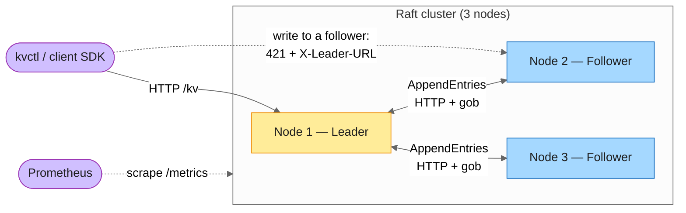
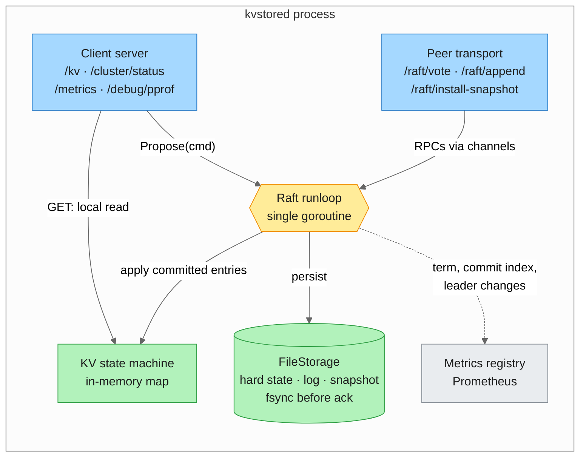
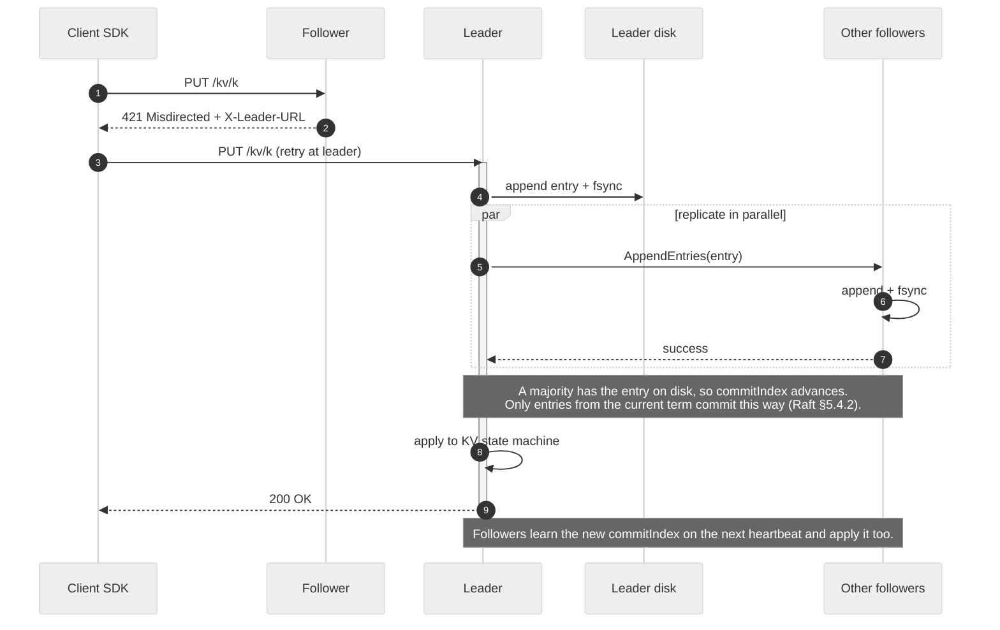
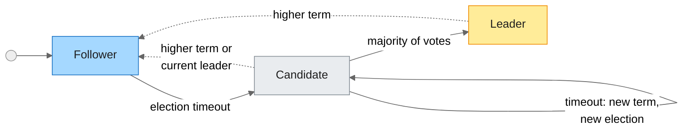
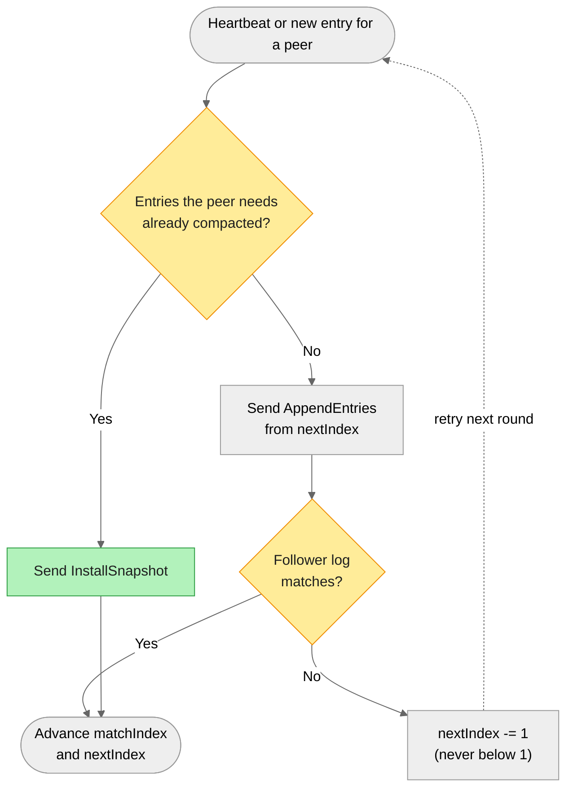
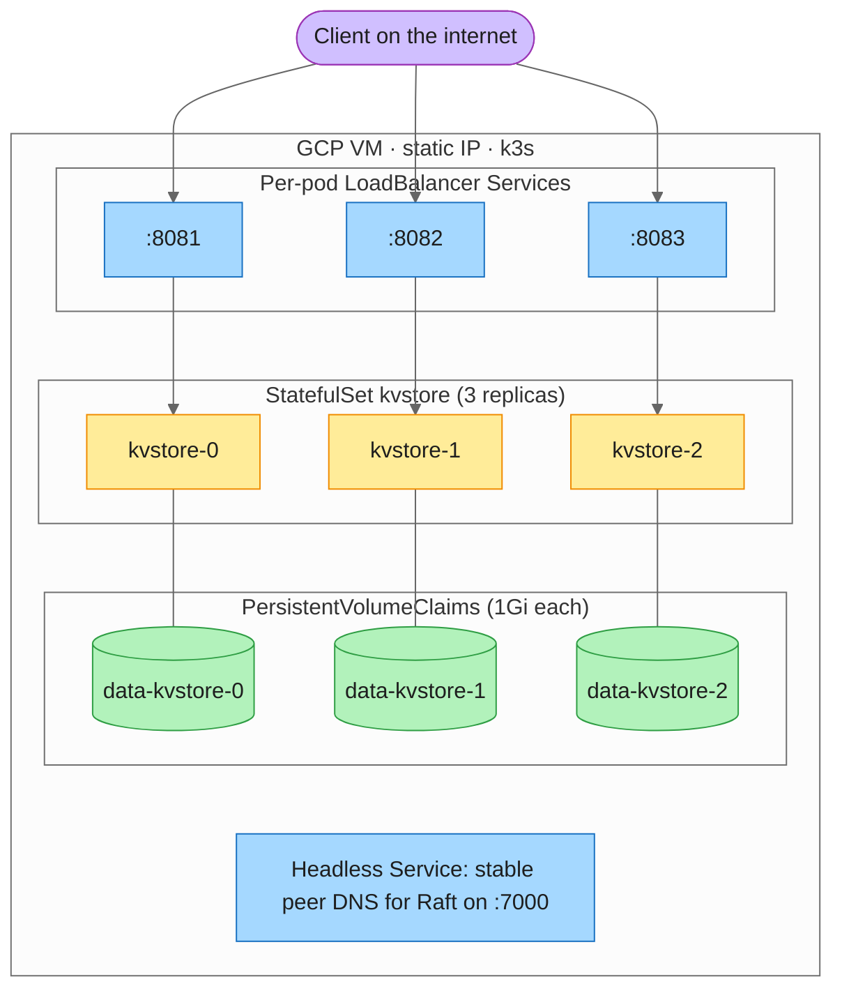

# Architecture

How the system is put together, from the whole cluster down to a single write. For why each piece was built the way it was, see the per-phase write-ups in this folder.

- [Cluster overview](#cluster-overview)
- [Inside one node](#inside-one-node)
- [Write path](#write-path)
- [Raft roles](#raft-roles)
- [Catching up a lagging follower](#catching-up-a-lagging-follower)
- [Deployment (Kubernetes / k3s)](#deployment-kubernetes--k3s)
- [Live dashboard](#live-dashboard)

## Cluster overview

Every node holds a full replica. Only the leader accepts writes; it replicates them to followers over a separate peer port, and an entry commits once a majority has it durably on disk.

## Inside one node

Each node runs two HTTP listeners, one for clients and one for Raft peers. Everything Raft-related goes through **one runloop goroutine** that owns term, vote, log, and commit index. Other goroutines reach it through channels rather than shared locks. The KV store is a pluggable state machine and only ever sees committed entries, in log order.

> Reads are served from the local state machine on whichever node receives them, so a follower or a partitioned old leader can return stale data. Linearizable reads (read-index) are planned for Phase 10.

## Write path

What happens on `kvctl put k v` when the client starts out talking to a follower:

## Raft roles

Dotted arrows are step-downs: any RPC that carries a higher term sends a node straight back to Follower.

- `votedFor` and `currentTerm` are fsync'd **before** any RequestVote goes out. A node that crashes mid-election can't vote twice in the same term.
- A new leader immediately appends a **no-op entry** for its term. Raft only commits older entries indirectly, through a current-term entry, so without the no-op a cluster restarted from cold could never re-advance its commit index until a client wrote something.

## Catching up a lagging follower

Every node compacts its own log into a snapshot once it has applied `--snapshot-interval` entries. If a follower is so far behind that the entries it needs have already been compacted on the leader, the leader sends its snapshot instead:

## Deployment (Kubernetes / k3s)

The live cluster runs as a 3-replica StatefulSet on a single k3s VM. Each pod gets its own persistent volume and its own public port. A follower's redirect has to send an outside client to the leader's public address, and a single shared load balancer can't provide one stable address per pod.

## Live dashboard

Every node serves a small dashboard at `/ui`. It is one HTML file embedded in the binary with `go:embed`, with no frontend build step and no external assets. The page asks the node it was loaded from for the member list (`/cluster/members`), then polls every node's `/cluster/status` and its own copy of the watched key twice a second. That is how it shows each replica converge, or fall behind, in real time. Nodes send permissive CORS headers so the page can reach peers on other ports. The client API was already public and unauthenticated, so this exposes nothing new.

The "Disconnect" button calls `POST /demo/isolate` on one node. The node then drops all of its Raft traffic in both directions for 15 seconds (`internal/transport/partition.go`), while its consensus code keeps running untouched. Everything you see afterwards is the real algorithm reacting:

- the other nodes miss heartbeats and elect a new leader;
- the cut-off node keeps its old view (an isolated leader still believes it leads, but can't commit anything);
- when the cut heals, it sees the newer term, steps down, and catches up.

The endpoint requires a shared secret in the `X-Demo-Token` header (`--demo-token` flag or `KV_DEMO_TOKEN` env var), compared in constant time. With no token configured the dashboard is read-only. Durations are clamped to 3–30 seconds, and a node that is already isolated refuses a second request.
